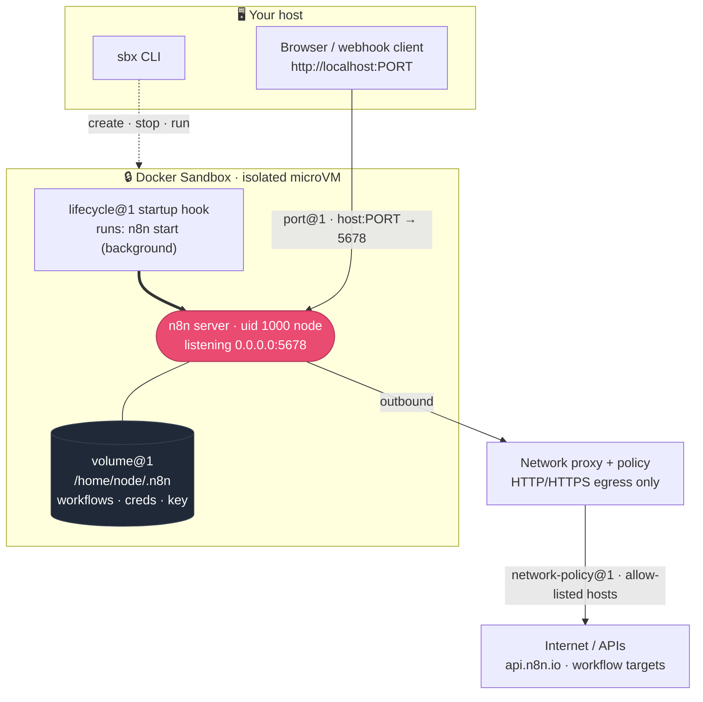

# sbx kit for n8n

Run [n8n](https://n8n.io) as a long-lived service inside a
[Docker Sandbox](https://docs.docker.com/ai/sandboxes/) (`sbx`) microVM. This is
a **v3 workload kit**: one descriptor (`n8n.yaml`) packages the official n8n
image so that `sbx run .` builds the kit, starts the n8n server, persists its
data, and forwards its editor/webhook port to your host.

Inspired by [Running n8n in a cloud sandbox](https://sandboxer.com/guides/run-n8n-in-a-cloud-sandbox),
adapted to Docker Sandboxes. The one difference from that cloud guide: Docker's
`sbx` exposes n8n via a **localhost port-forward on an ephemeral host port**, not
a public HTTPS URL — see [Public webhooks](#public-webhooks).

## Architecture



- **`long-running@1`** keeps the microVM alive after the launching client
  detaches — n8n is a server, not a session.
- **`lifecycle@1`** startup hooks own the data volume, then launch `n8n start` in
  the background. (sbx runs a keepalive as PID 1 and does **not** auto-start the
  image entrypoint, so the service is started explicitly.)
- **`port@1`** publishes container port 5678 to an ephemeral host port.
- **`volume@1`** persists `/home/node/.n8n` across stop / start / recreate.
- **`network-policy@1`** controls egress; every outbound request leaves through
  the sandbox HTTP/HTTPS proxy.

The kit deliberately does **not** declare `sbx@1`: n8n is a service, so we run
its own server rather than have the host replace the entrypoint with an agent
launcher.

## Quick start

### From the published image

```sh
sbx create docker.io/ajeetraina777/n8n:2.47.7
sbx ls | grep n8n               # find the forwarded host port
```

> Use `sbx create`, **not** `sbx run`. This is a workload kit (no `sbx@1`): n8n
> runs as a detached background service, so there is no agent to attach to.
> `sbx run` creates the sandbox and then tries to open an interactive agent
> session (`chdir /home/agent` + `exec /bin/bash`), which fails with `code 127`
> because the Alpine-based n8n image has neither `/home/agent` nor `/bin/bash`.
> The sandbox itself is created and n8n starts fine — only the attach fails. Use
> `sbx exec -it <name> /bin/sh` if you need a shell inside.

### From source

```sh
git clone https://github.com/ajeetraina/sbx-kits-n8n
# reference the kit by its directory (run from the parent dir)
sbx create --name n8n-demo ./sbx-kits-n8n
sbx ls | grep n8n-demo          # find the forwarded host port
```

`sbx ls` shows a mapping like `127.0.0.1:49157->5678/tcp4`. Open
`http://localhost:49157` and complete the n8n owner setup.

> Login works over plain HTTP because the image sets `N8N_SECURE_COOKIE=false`.

### Lifecycle

```sh
sbx stop n8n-demo               # pause; the volume is preserved
sbx run -d n8n-demo             # resume detached — the startup hook relaunches n8n (new port)
sbx exec -it n8n-demo /bin/sh   # shell inside (Alpine: sh, not bash)
sbx rm -f n8n-demo              # delete the sandbox and its volume
```

> Resume with `sbx run -d` (detached), not a bare `sbx run` — the `-d` skips the
> interactive agent attach this workload does not have, which would otherwise
> fail with `code 127`.

## Build & verify

```sh
# 1. validate the descriptor (fast)
docker buildx build . -f n8n.yaml --output type=cacheonly

# 2. build an OCI layout and run conformance (kit-tck)
docker buildx build . -f n8n.yaml -t n8n:2.47.7 \
  --output type=oci,dest=/tmp/n8n-layout,tar=false
kit-tck validate --layout /tmp/n8n-layout 2.47.7

# 3. inspect resolved declarations without creating a sandbox
sbx kit inspect ./sbx-kits-n8n
```

## Public webhooks

Docker Sandboxes forward n8n to `localhost`, so externally-delivered webhooks are
not reachable out of the box. Run the tunnel **on your host**, in front of the
forwarded port:

```sh
port=$(sbx ls | grep n8n-demo | grep -oE '127.0.0.1:[0-9]+' | cut -d: -f2)
cloudflared tunnel --url "http://localhost:$port"    # or: ngrok http $port
```

Then set n8n's `WEBHOOK_URL` to the tunnel URL (fork the kit and add it to the
startup hook's environment, or recreate with that value).

> **Why host-side, not a tunnel kit inside the sandbox?** A sandbox's only
> egress is an HTTP/HTTPS forward proxy (`gateway.docker.internal:3128`) with
> TLS interception. `cloudflared` reaches Cloudflare's edge over a raw
> TCP/QUIC connection on port 7844, which that proxy does not carry — so a
> `cloudflared` process *inside* the sandbox cannot register a tunnel (it also
> can't fetch its own binary past the MITM proxy). The host has normal
> networking, so the tunnel belongs there, pointed at the forwarded port.

## Letting workflows reach the internet

The editor boots fully offline (telemetry and version checks are disabled). When
a workflow's **HTTP Request node** (or an integration) needs an external host,
grant it at runtime:

```sh
sbx policy allow network api.github.com
sbx policy allow network "*.googleapis.com"
sbx policy log            # see what was allowed / blocked
```

Or fork the kit and add the hosts to the `network-policy@1` `runtime.allow` list
in `n8n.yaml`.

## Pinning a different n8n version

The `version` arg drives the pulled image tag, the `provides` entry and the
published version in one place, and the build fails if the installed n8n does not
match:

```sh
sbx create --name n8n-demo --kit-arg version=2.47.7 ./sbx-kits-n8n
# or build directly:
docker buildx build . -f n8n.yaml --build-arg N8N_VERSION=2.47.7 ...
```

## Publish

Published as a multi-arch (amd64 + arm64) image at
[`docker.io/ajeetraina777/n8n`](https://hub.docker.com/r/ajeetraina777/n8n):

```sh
docker buildx build . -f n8n.yaml --platform linux/amd64,linux/arm64 --push \
  -t docker.io/ajeetraina777/n8n:2.47.7 -t docker.io/ajeetraina777/n8n:latest
```

Push both platforms in one invocation so the pushed tag is a multi-arch index.

> If the base pull hits `docker.n8n.io`'s anonymous rate limit (HTTP 429), add
> `--build-arg N8N_IMAGE=docker.io/n8nio/n8n` to pull the identical image from
> Docker Hub under your authenticated limit.

### CI

[`.github/workflows/publish.yml`](.github/workflows/publish.yml) publishes on a
semver git tag: it gates on `kit-tck` conformance, builds + pushes the
multi-arch image, and signs it keylessly with `cosign`.

```sh
git tag 2.47.7 && git push origin 2.47.7
```

Needs two repo secrets: `DOCKERHUB_USER` and `DOCKERHUB_PAT` (an access token
with read/write). The tag name becomes both the n8n version and the image tag.

Verify a signature (keyless — the identity is the workflow, not a key):

```sh
cosign verify docker.io/ajeetraina777/n8n:2.47.7 \
  --certificate-identity 'https://github.com/ajeetraina/sbx-kits-n8n/.github/workflows/publish.yml@refs/tags/2.47.7' \
  --certificate-oidc-issuer https://token.actions.githubusercontent.com
```

## How it compares to the cloud guide

| | Sandboxer (the guide) | Docker Sandboxes (this kit) |
|---|---|---|
| Start n8n | manual `docker run` inside the box | `sbx run .` — packaged as a kit |
| Exposure | public `https://…box.sandboxer.com` URL | `localhost:<ephemeral>` port-forward |
| Persistence | Docker volume you create | declared `volume@1` on `/home/node/.n8n` |
| Reproducible | step-by-step commands | one descriptor (`n8n.yaml`) |

## Files

- `n8n.yaml` — the kit descriptor (capabilities, args, version).
- `n8n.dockerfile` — content recipe: `FROM docker.n8n.io/n8nio/n8n`, version
  enforcement, runtime `ENV`.
